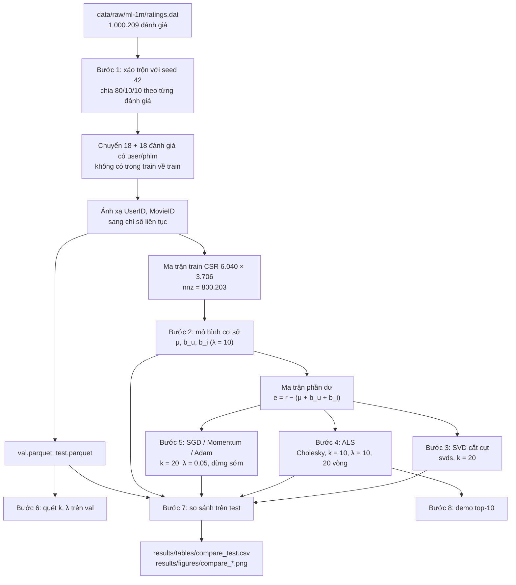

# mf-recsys: hệ gợi ý phim bằng phân rã ma trận

Bài tập lớn môn AS2069 *Phương pháp số cho Khoa học dữ liệu*, ĐH Bách Khoa – ĐHQG-HCM.
Đề tài: dự đoán số sao còn thiếu trong ma trận người dùng × phim của MovieLens-1M bằng phân rã
R ≈ μ + b_u + b_i + P Qᵀ, rồi so sánh ba phương pháp số tìm phân rã (SVD cắt cụt, ALS, SGD) về
độ chính xác, tốc độ hội tụ và tính chất số. Chỉ số chính: RMSE trên tập test.

- Dữ liệu: <https://grouplens.org/datasets/movielens/1m/>
- Bài báo nền: Koren, Bell, Volinsky, *Matrix Factorization Techniques for Recommender Systems*,
  IEEE Computer, 2009.

Mọi mô hình dùng chung một dạng dự đoán và chung một tầng cơ sở:

1. **Mô hình cơ sở.** μ là điểm trung bình của tập train; b_u, b_i là độ lệch của người dùng và của
   phim, co về 0 theo hệ số n/(n + λ) (hồi quy Ridge một biến). Các độ lệch được cố định.
2. **Phân rã phần dư.** Cả ba phương pháp chỉ học phần tương tác p_uᵀq_i trên ma trận phần dư
   e_ui = r_ui − (μ + b_u + b_i), nên khác biệt về kết quả chỉ đến từ bản thân phương pháp:
   - **SVD cắt cụt:** điền 0 vào ô trống của ma trận phần dư (vẫn thưa), lấy k giá trị kỳ dị lớn
     nhất bằng `scipy.sparse.linalg.svds`.
   - **ALS:** luân phiên giải hệ Ridge (Q_uᵀQ_u + λI) p_u = Q_uᵀe_u cho từng người dùng, rồi hệ
     tương tự cho từng phim, bằng phân rã Cholesky tự cài (biên dịch bằng numba, chạy song song).
   - **SGD:** giảm gradient theo mini-batch với ba bộ tối ưu (SGD thường, Momentum, Adam), dừng sớm
     theo RMSE trên tập val.
3. **Gợi ý.** Với một người dùng, xếp các phim chưa xem theo điểm dự đoán và lấy 10 phim đầu.

## Cài đặt

Python 3.11 trở lên (phát triển trên 3.12). Chạy mọi lệnh tại thư mục `mf-recsys/`.

```bash
python -m venv .venv
# Windows: .venv\Scripts\activate    macOS/Linux: source .venv/bin/activate
pip install -r requirements.txt
```

## Dữ liệu

Giấy phép của MovieLens-1M không cho phát hành lại dữ liệu, nên `data/` không được commit. Lệnh sau
tải `ml-1m.zip` từ GroupLens, kiểm tra mã MD5 rồi giải nén vào `data/raw/ml-1m/`:

```bash
python -m src.data.download
```

Nhóm chỉ dùng `ratings.dat` để học (1.000.209 đánh giá, 6.040 người dùng, 3.706 phim có đánh giá,
thưa 95,53%) và `movies.dat` để in tên phim khi gợi ý.

## Chạy toàn bộ

Chạy lần lượt các bước dưới đây, từ thư mục gốc repo và luôn qua `python -m` để `import src` hoạt
động. Toàn bộ mất khoảng 4 phút trên CPU.

| Bước | Lệnh | Việc làm | Thời gian (CPU) |
|---|---|---|---|
| 0 | `python -m src.data.download` | Tải và kiểm tra MovieLens-1M | vài giây |
| 1 | `python -m src.data.preprocess` | Chia train/val/test, ánh xạ ID, lưu ma trận train dạng CSR | ~15 s |
| 2 | `python -m experiments.run_baseline` | Global mean và mean + bias, lưu `baseline.pkl` | ~5 s |
| 3 | `python -m experiments.run_svd` | SVD cắt cụt, phổ giá trị kỳ dị, lưu `svd.pkl` | ~5 s |
| 4 | `python -m experiments.run_als` | ALS + Cholesky, đường hội tụ, số điều kiện theo λ, lưu `als.pkl` | ~20 s |
| 5 | `python -m experiments.run_sgd` | So sánh SGD, Momentum, Adam (dừng sớm), lưu `sgd_best.pkl` | ~1,5 phút |
| 6 | `python -m experiments.tune_k_lambda` | Quét k (ALS, SVD) và λ (ALS) trên tập val | ~40 s |
| 7 | `python -m experiments.compare_all` | Bảng RMSE trên **tập test** và các hình so sánh | ~10 s |
| 8 | `python -m src.recommend --user-id 42 --model als` | Demo: top 10 phim gợi ý cho một người dùng | vài giây |

Bước 7 đọc các mô hình do bước 2–5 lưu, nên phải chạy sau cùng. Đây là nơi duy nhất dùng tập test.
Bảng ra `results/tables/`, hình ra `results/figures/`, mô hình ra `results/models/`.

Kiểm thử (39 test trên ma trận nhỏ biết trước đáp án):

```bash
python -m pytest -q
```

Xem toàn bộ kết quả cạnh nhau: mở `notebooks/02_results.ipynb` sau khi chạy xong bước 7. Notebook chỉ
đọc bảng và hình trong `results/`, không huấn luyện lại.

### Sơ đồ quy trình



### 1. Tiền xử lý

`ratings.dat` được xáo trộn với seed 42 rồi cắt 80/10/10 theo từng đánh giá. Một đánh giá trong val
hoặc test chỉ dự đoán được khi cả người dùng lẫn phim đã có trong train, nên 36 đánh giá không thỏa điều
kiện này (18 ở val, 18 ở test) được chuyển về train. Kết quả: 800.203 / 100.002 / 100.004 đánh giá.
MovieID chạy tới 3.952 nhưng chỉ 3.706 mã có đánh giá, nên mã được đổi sang chỉ số liên tục. Ma trận
train lưu dạng CSR: 9,63 MB so với 179,07 MB nếu lưu đầy đủ (nhỏ hơn 18,6 lần).

### 2. Mô hình và tham số

| Mô hình | k | λ | Tham số khác |
|---|---|---|---|
| Mean + bias | – | 10 | hệ số co của b_u, b_i |
| SVD cắt cụt | 20 | – | `svds` trên ma trận phần dư |
| ALS | 10 | 10 | 20 vòng, Cholesky tự cài |
| SGD | 20 | 0,05 | SGD thường, η = 0,05, batch 4.096, dừng sớm sau 3 epoch không cải thiện |

Tham số được chọn trên tập val: với ALS, quét k ở λ = 10 rồi quét λ ở k tốt nhất (bước 6); với SGD,
chọn λ và bộ tối ưu có RMSE val thấp nhất (bước 5). Mọi tham số nằm trong
[configs/default.yaml](configs/default.yaml); muốn thử cấu hình khác, chép file đó rồi thêm
`--config configs/ten_file.yaml` vào lệnh.

### Kết quả

Tập test, 100.004 đánh giá (bước 7):

| Mô hình | RMSE val | RMSE test | MAE test | Giảm RMSE so với mean + bias | Thời gian huấn luyện |
|---|---|---|---|---|---|
| Global mean | 1,1165 | 1,1165 | 0,9332 | – | 0,002 s |
| Mean + bias | 0,9103 | 0,9085 | 0,7183 | mốc | 0,04 s |
| SVD cắt cụt | 0,8840 | 0,8815 | 0,6937 | 3,0% | 0,37 s |
| **ALS** | **0,8603** | **0,8553** | **0,6667** | **5,9%** | 0,49 s |
| SGD | 0,8647 | 0,8621 | 0,6744 | 5,1% | 10,4 s |

- ALS chính xác nhất và nhanh hơn SGD khoảng 21 lần. Hàm mục tiêu của ALS giảm ở mọi vòng.
- SVD kém hơn vì phải coi các ô trống là phần dư bằng 0.
- Phần lớn mức giảm sai số so với trung bình toàn cục đến từ độ lệch b_u, b_i.

Thời gian đo trên CPU AMD Ryzen 7 H 255 (16 luồng), chỉ tính phần huấn luyện, không tính phần đánh giá.
ALS chạy song song bằng numba còn SGD chạy bằng NumPy, nên tỉ lệ thời gian phụ thuộc cả cách cài đặt.

## Tái lập

Mọi nguồn ngẫu nhiên dùng seed 42 (`seed` trong cấu hình): cách chia dữ liệu, khởi tạo P và Q, thứ tự
duyệt dữ liệu của SGD. Chạy lại `src.data.preprocess` cho đúng cùng một cách chia. Kết quả ALS không
phụ thuộc số luồng của CPU (có test kiểm tra). Thời gian chạy thay đổi theo máy.

## Cấu trúc repo

```text
mf-recsys/
├── README.md
├── ROADMAP.md                    # lộ trình 2 tuần và tiêu chí "xong" của từng bước
├── requirements.txt
├── configs/
│   └── default.yaml              # toàn bộ tham số: seed, tỉ lệ chia, k, λ, lr, số epoch, lưới quét
├── doc/
│   └── TIEN_DO.md                # tiến độ và nhận xét review
├── src/
│   ├── config.py                 # đọc YAML, đặt seed
│   ├── recommend.py              # demo: UserID -> top-10 phim
│   ├── data/
│   │   ├── download.py           # tải, kiểm tra MD5, giải nén ML-1M
│   │   ├── load.py               # đọc ratings.dat, movies.dat
│   │   ├── preprocess.py         # chia tập, xử lý cold-start, ánh xạ ID
│   │   └── sparse.py             # dựng, lưu, đọc CSR; so sánh bộ nhớ
│   ├── models/
│   │   ├── base.py               # giao diện chung: fit, predict, recommend, save, load
│   │   ├── baseline.py           # global mean; mean + bias
│   │   ├── svd.py                # SVD cắt cụt trên ma trận phần dư
│   │   ├── als.py                # ALS, giải hệ bằng Cholesky (numba, song song)
│   │   └── sgd.py                # SGD, Momentum, Adam theo mini-batch, dừng sớm
│   ├── solvers/
│   │   └── linear.py             # phân rã Cholesky, thế tiến, thế lùi tự cài
│   ├── evaluation/
│   │   ├── metrics.py            # RMSE, MAE
│   │   ├── convergence.py        # nhật ký theo vòng lặp và thời gian
│   │   └── conditioning.py       # số điều kiện của hệ ALS theo λ
│   └── visualization/
│       └── plots.py              # hàm vẽ dùng chung
├── experiments/
│   ├── run_baseline.py           # bước 2
│   ├── run_svd.py                # bước 3
│   ├── run_als.py                # bước 4
│   ├── run_sgd.py                # bước 5
│   ├── tune_k_lambda.py          # bước 6
│   └── compare_all.py            # bước 7, nơi duy nhất dùng tập test
├── notebooks/
│   ├── 01_eda.ipynb              # phân tích khám phá, xuất hình cho báo cáo
│   └── 02_results.ipynb          # xem và đối chiếu toàn bộ kết quả
├── tests/
│   ├── test_metrics.py
│   ├── test_base.py
│   └── test_models_small.py      # mô hình trên ma trận nhỏ biết trước đáp án
├── data/                         # không commit
│   ├── raw/ml-1m/                #   dữ liệu gốc (bước 0)
│   └── processed/                #   train/val/test .parquet, id_maps.npz, train_csr.npz (bước 1)
└── results/                      # sinh tự động, không commit
    ├── tables/                   #   bảng .csv
    ├── figures/                  #   hình .png
    └── models/                   #   mô hình đã huấn luyện .pkl
```

## Trích dẫn dữ liệu

F. Maxwell Harper, Joseph A. Konstan. *The MovieLens Datasets: History and Context*. ACM Transactions on
Interactive Intelligent Systems 5(4), 2015. <https://doi.org/10.1145/2827872>
